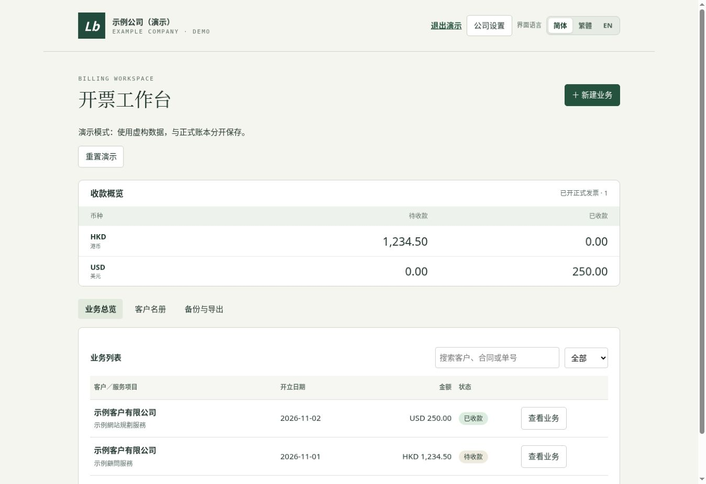

# Josie Xiang · 产品作品集

## 直接使用

| 软件 | 在线打开 | 下载到电脑 |
| --- | --- | --- |
| 本地开票工作台 | **[打开开票工具](https://josie-billing-workspace.coral-ox-0471.chatgpt.site/)** | [下载离线版 ZIP](https://josie-billing-workspace.coral-ox-0471.chatgpt.site/Billing-Workspace-v0.2.0.zip) |
| 爱你老己 · 像素小院 | **[进入像素小院](https://aini-laoji-garden-v7.coral-ox-0471.chatgpt.site/)** | [下载离线版 ZIP](https://aini-laoji-garden-v7.coral-ox-0471.chatgpt.site/downloads/aini-laoji-v0.8.1.zip) |

在线版点开即可使用。第一次用开票工具，可以[先看虚构演示](https://josie-billing-workspace.coral-ox-0471.chatgpt.site/?demo=1)。离线版下载后，**解压 ZIP → 用 Chrome 打开里面的 HTML 文件**。

[使用说明与备份迁移](USING_THE_APPS.md) · [报告问题](https://github.com/josephinexyy/product-portfolio/issues/new?template=bug.yml) · [提个建议](https://github.com/josephinexyy/product-portfolio/issues/new?template=idea.yml)

## 产品与设计

[开票工具：问题、设计与迭代](cases/local-billing-workspace.md) · [像素小院：初衷、玩法与设计](cases/aini-laoji.md)

### 本地开票工作台

从自己处理香港小生意的经历出发，先把一笔业务理顺，再关联付款通知、发票和收据。重点迭代了业务入口、历史单据资料保留、备份恢复，以及不用先填真实资料的演示体验。

### 爱你老己 · 像素小院

做这个小院的初衷，是**看见自己，把自己的一天具象化**。我想让日常在小院里有一个看得见的样子，让自己能回看这一天是怎样度过的，也记得照顾其中的自己。

当前为手动交互原型，可以操作、闲逛和种小苗；完整生活时间线、提醒及外部事件接入尚待实现。

## 使用自己的数据

开票工具可以正式开单，不局限于虚构演示。首次使用先设置自己的公司资料。账本保存在当前网址、当前浏览器中；换文件、网址或设备前，先从旧版本导出完整备份，再在新版本导入。

**下载软件不会自动带回以前的账本。** 演示数据与正式账本分开，公开版本不包含创作者的真实客户和业务记录。详见[使用与数据迁移](USING_THE_APPS.md)。

## 关于我与反馈

我是一名产品经理，喜欢倒腾小硬件、小软件，也喜欢琢磨让日常体验更顺手的小设计。我负责需求、流程与体验设计和迭代，使用 AI 辅助实现。这里记录为什么做、做了哪些取舍，以及反馈怎样变成下一次修改。

欢迎通过顶部的“报告问题”或“提个建议”反馈，提交时需要登录 GitHub。请用虚构数据举例，截图前遮住个人和业务资料。

[公开迭代记录](UPDATES.md) · [素材与软件授权说明](NOTICES.md)
