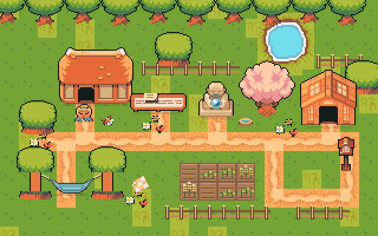

# Josie Xiang · 产品作品集

我是一名产品经理，喜欢倒腾小硬件、小软件，也喜欢琢磨让日常体验更顺手的小设计。

这里记录从实际需要出发做出来的两个产品：为什么做、做了哪些取舍，以及使用中的问题怎样变成下一次修改。我负责需求、流程与体验设计和迭代，使用 AI 辅助实现。

**软件对所有人开放使用。** 可以在线体验，也可以下载到自己的电脑。这个仓库展示产品案例、界面和公开迭代记录；完整开发工程单独维护。

## 选择一个试试

| 产品 | 想解决什么 | 直接使用 | 了解设计 |
| --- | --- | --- | --- |
| 本地开票工作台 | 帮个人工作室、小老板理清客户、开单与收款 | [在线使用](https://josie-billing-workspace.coral-ox-0471.chatgpt.site) · [先看虚构演示](https://josie-billing-workspace.coral-ox-0471.chatgpt.site/?demo=1) · [下载离线版](https://josie-billing-workspace.coral-ox-0471.chatgpt.site/Billing-Workspace-v0.2.0.zip) | [产品案例](cases/local-billing-workspace.md) |
| 爱你老己 · 像素小院 | 让现实中的自己与小院里的自己相互映照、相互照顾 | [直接玩](https://aini-laoji-garden-v7.coral-ox-0471.chatgpt.site) · [下载离线版](https://aini-laoji-garden-v7.coral-ox-0471.chatgpt.site/downloads/aini-laoji-v0.8.0.zip) | [玩法与设计](cases/aini-laoji.md) |

### 本地开票工作台

从自己处理香港小生意的经历出发，先把一笔业务理顺，再关联付款通知、发票和收据。重点迭代了业务入口、历史单据资料保留、备份恢复，以及不用先填真实资料的演示体验。

### 爱你老己 · 像素小院

你在现实中上班，小院里的小人过着与你对应的生活：午休躺吊床，开会去村口，喝水「大水理论」和上厕所也映射成他的动作。你照顾小人，也通过他的生活记得照顾自己。这份相互照顾是产品的核心。

当前为手动交互原型，可以操作、闲逛和种小苗；完整生活时间线、提醒及外部事件接入尚待实现。

## 使用自己的数据

开票工具可以正式开单，不局限于虚构演示。首次使用先设置自己的公司资料。账本保存在当前网址、当前浏览器中；换文件、网址或设备前，先从旧版本导出完整备份，再在新版本导入。

**下载软件不会自动带回以前的账本。** 演示数据与正式账本分开，公开版本不包含创作者的真实客户和业务记录。详见[使用与数据迁移](USING_THE_APPS.md)。

## 欢迎反馈

[使用中卡住了](https://github.com/josephinexyy/product-portfolio/issues/new?template=bug.yml) · [我有个建议](https://github.com/josephinexyy/product-portfolio/issues/new?template=idea.yml)

想听具体的体验：哪个操作需要停下来想？哪一处比例、提示或流程让你不舒服？请用虚构数据举例，截图前遮住个人和业务资料。

[公开迭代记录](UPDATES.md) · [素材与软件授权说明](NOTICES.md)
