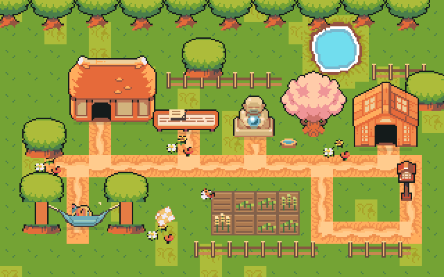

# 爱你老己：和小院里的自己相互照顾

**[进入像素小院](https://aini-laoji-garden-v7.coral-ox-0471.chatgpt.site/)** · [下载离线版 ZIP](https://aini-laoji-garden-v7.coral-ox-0471.chatgpt.site/downloads/aini-laoji-v0.8.0.zip) · [使用说明](../USING_THE_APPS.md#爱你老己--像素小院) · [返回软件入口](../README.md#直接使用)

**现实中的我，和小院里的我，相互照顾。**

## 为什么做

我在现实中上班、开会、休息，小院里的小人过着与我对应的生活。自己午休，他就躺吊床；自己开会，他就去村口。喝水、上厕所这些日常，也在虚拟世界留下对应的动作。

我希望现实中的自己与虚拟的自己能相互照顾。我照顾小人，也能通过他的生活看见自己的状态，记得喝水、休息、照顾身体。小人是另一个被我认真对待的自己，这份关心也回到现实生活里。

生活映射与相互照顾是核心体验。当前原型先用手动交互表达这层关系；自动记录、提醒和外部数据接入仍是后续设计方向。

## 怎样设计

| 现实中的自己 | 小院里的表达 | 目前状态 |
| --- | --- | --- |
| 午休 | 躺进两棵树之间的吊床 | 可手动触发，记录当天休息次数 |
| 开会 | 去村口坐下来，散会再回院子 | 可手动进入与返回会议场景 |
| 喝水，「大水理论」 | 去井边喝水，小猫也有水碗 | 可手动触发，记录当天喝水次数；提醒待完善 |
| 上厕所 | 去洗手间的小木屋 | 已有对应动作；完整记录与提醒待完善 |
| 开会时心率变化 | 把时间、数值与当时的会议放在一起回看 | 设计方向，尚未接入 Apple Watch |
| 工资到账 | 麦子成熟，等自己来收获 | 设计方向；当前工资按钮只模拟增加金币 |

手动拖动对应主动开始一件事。小人可以自己闲逛，但闲逛不会替自己完成喝水、休息或工作。菜园给一件小事起名字，每次只种一格，清单是否完成仍由自己确认。

## 根据反馈改了什么

| 收到的反馈或发现 | 迭代 | 想改善的体验 |
| --- | --- | --- |
| 小人走得太快 | 按实际时间移动，提供更慢的步速和停一停 | 让人愿意在院子里待着 |
| 画面不够精美，图层和物件关系不对 | 采用同一套授权明确的像素素材，等比切图；重对门洞、树根、家具和吊床 | 人、物件与动作的位置要说得通 |
| 拖动之后突然出现在物件里 | 松手后从原位置步行到目标，绕开实物 | 拖拽表达意图，过程仍连续 |
| 担心隔天或换环境丢进度 | 跨日保留待办和小苗，提供备份与恢复 | 做过的事能留住 |
| 别人开始体验要先下载、理解文件 | 提供直接玩的公开网页和独立离线包 | 点开就能试，方便反馈 |

## 当前边界与下一步

当前是 v0.8.0 / v8 原型，提供手动操作和模拟事件；尚未连接飞书、Apple Watch 或真实工资数据。生活时间线、喝水及上厕所提醒、会议期间的心率关联、工资触发麦子成熟并手动收获，是后续方向。

已有 12 项规则与素材检查，以及真实游戏脚本的离线 Canvas 流程检查。本轮完整的真实浏览器和手机设备试玩尚待补充。上面的图片是离线渲染预览，不当作设备验证证明。

下一步优先收集实际试玩中的比例、遮挡、拖拽和步速问题，再补完整记录与提醒。不会把尚未接入的数据源写成已经完成。

**我的工作：**玩法概念、现实生活映射、体验设计和反馈驱动的迭代；使用 AI 辅助实现。主要美术为 Pixel-Boy 和 AAA 的 Ninja Adventure，按 CC0 使用，并补充少量配套图。
