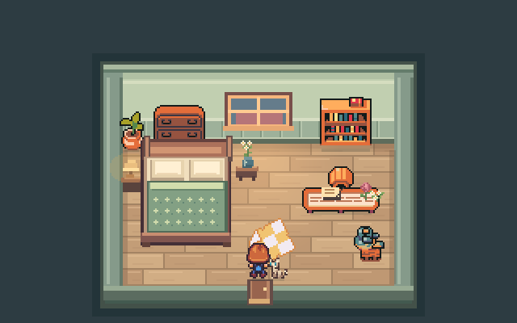

# 爱你老己 · 像素小院

**看见自己，把自己的一天具象化。** 我想做一个和我一起上班的小人。我开会，他就去村口；我午休，他就躺进吊床。看着他过这一天，我也会想起自己上一次喝水是什么时候。

[进入小院](https://josephinexyy.github.io/product-portfolio/garden/) · [下载离线版 v0.28.0](https://josephinexyy.github.io/product-portfolio/garden/aini-laoji-v0.28.0.zip) · [更新历史](aini-laoji-changelog.md) · [反馈问题或建议](https://github.com/josephinexyy/product-portfolio/issues/new/choose)

## 线上现在怎么玩 · v0.28.0

1. **在小院里走走。** 点路面或草地，小人就会走过去。从门廊沿碎石路可以走到池边。靠近长椅、心愿墙或吊床时，会出现可点的操作提示。要喝水，可以点水井。去村里开会和上厕所也可以从菜单选。结束午休或散会后，可以在日记里回看时长。午休时，Milky 会在吊床旁的猫垫上睡一会儿。
2. **种花，等它开。** 点一块空地，可以选向日葵、玫瑰或茉莉。想只种花，就把小事留空。等地块闪光，再点一下就能收进篮子。如果把一件待办种了下去，完成同名待办也能让作物成熟。
3. **给自己留一句话。** 点门廊旁的「心愿墙」，写一句 15 字以内的话。黑板会显示最新一条，旧留言可以点开回看。
4. **看一会儿黄昏。** 点池塘，Milky 会在岸边陪你。想看窗灯亮起来，可以点「看黄昏」，也可以直接点「回家」。回家的路上天会慢慢暗下来，小猫会先到门口等你。
5. **把一朵花带回家。** 进屋后点「床头插花」，就能从篮子里挑一枝带到床头。如果当天有午休、收获等记录，可以点书桌上的小纸条。选「收进日记」，再改成自己的话。也可以去书桌写日记，选心情、回看或补记这一天的活动。「保存日记并睡觉」之后，Milky 会跳到另一只枕头上。也可以直接点「上床睡觉」。

6. **给今天留张照片。** 在小院或小屋点「留张照片」，预览后选择放进今天的日记。想回看时，点小屋里的书架或「翻翻这周」，选日期就能看见那天写的话和留下的照片。

v0.25.0 换了浅灰绿的墙和暖木色地板。屋里有书桌椅、矮斗柜和茶几，熄灯后也能看清墙脚。

日记、照片、心愿和种下的花都保存在当前浏览器里。换设备时，可以用「带走小院」下载存档，再用「恢复备份」接着玩。

## 我怎样决定什么值得记录

小人可以自己闲逛。喝水、午休和上厕所由我主动开始，各自记录次数。如果小人走到水井旁就算我喝了一杯水，回头看到的就不是我真实的一天了。菜园也沿用这个想法：我可以把一件待办种成麦子，但事情做完了，要由我自己勾选。

## 试玩后做的几次修改

| 试玩时发现 | 我做的修改 |
| --- | --- |
| 小人上了吊床就拖不动，只能等午休结束 | 让躺着的小人也能被拖走。起身时按实际经过时间结算，拖走也能记录已经休息多久。 |
| 猫和厕所都要靠猜 | 早期重画了橘猫的尖耳、条纹和翘尾，在小木屋门上写清楚 Toilet。后来换成了有四向步态的 Milky。人物、门和家具继续按同一像素比例绘制。 |
| 待办能写下要做的事，有时我只想说“今天不准加班了” | 加一面心愿墙。写下这句话，墙上就画一只长翅膀的钟。周一开会会变成划掉的对话框。写的时候字就带着粉笔纹理，每条新留言最多 15 字。院里能看最新一句，完整留言留在自己的浏览器。 |
| 一天过去了，想回头看看自己都做过什么 | 回家后可以到书桌打开日记，把会议、喝水、午睡和如厕写进同一页。日记可以选心情、留几句给自己，也可以把墙上的一句心愿放进竖版像素小院卡片。下方有时间线，能补记和撤销误触。散会时会留下实际时长和选填的感受。做完一件事，可以让同名作物成熟，再把花收进篮子。写完日记可以去睡觉，小猫会跟着跳上床，蜷在另一只枕头旁边。 |

当前的小人用的是 [The Game Smith 的免费 Legacy 人物](https://not-a-kappa-games.itch.io/farming-sim-character-base)。小猫的四向步行动画来自 [Revouger 的 Milky Cat 免费样例](https://revouger.itch.io/milky-cat)，枕边蜷睡的动作由小院制作。

## 接下来想试的两件事

先把喝水和上厕所的提醒做好。再试试怎样把外部事件放回当天的情境里：开会时能回看 Apple Watch 记录的心率；飞书传来工资到账消息，院子里的麦子就成熟，等自己去收。当前版本采用手动操作，外部事件仅供模拟。

玩法与体验设计：Josephine Xiang，使用 AI 辅助实现。[素材说明](../NOTICES.md)
