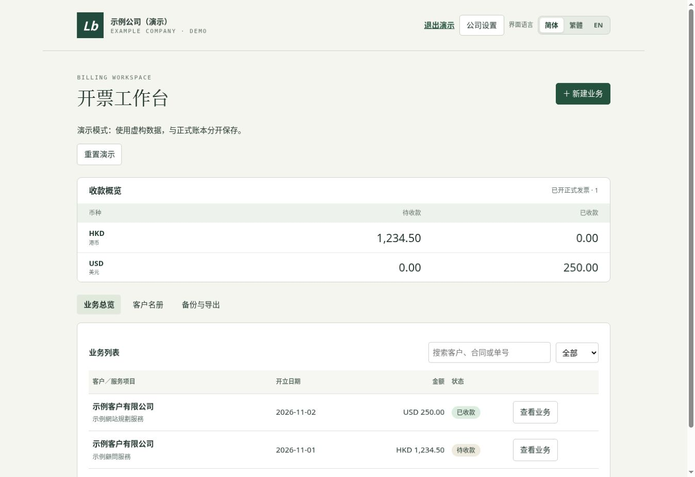
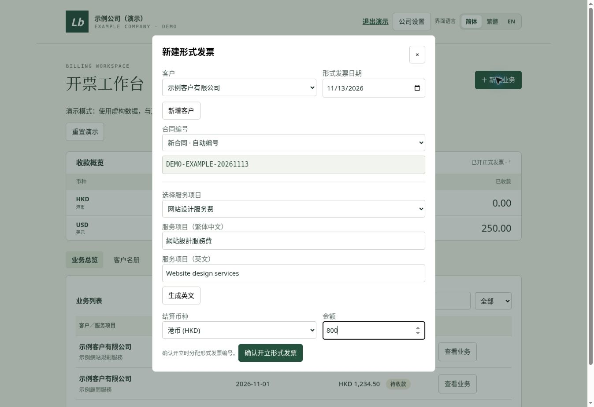

# 本地开票工作台：让一个人也能把业务往来理清楚

**[打开开票工具](https://josie-billing-workspace.coral-ox-0471.chatgpt.site/)** · [先看虚构演示](https://josie-billing-workspace.coral-ox-0471.chatgpt.site/?demo=1) · [下载离线版 ZIP](https://josie-billing-workspace.coral-ox-0471.chatgpt.site/Billing-Workspace-v0.2.0.zip) · [使用说明](../USING_THE_APPS.md#本地开票工作台) · [返回软件入口](../README.md#直接使用)

**适用人群：**个人工作室、自由职业者和个体经营者，尤其是需要港币 / 美元和中英文单据的香港服务业务。

## 为什么做

自己处理小生意时，客户资料会反复填写，收到钱后还要找到对应业务，再区分付款通知、发票和收据。每件事都不大，但连续做起来，很容易打断工作。

我希望一个人经营，也能把记录整理清楚，对外单据看起来专业、体面。因此先聚焦单人服务业务，不急着扩展成完整财务系统。

## 怎样设计

入口先回答“这笔业务到哪一步了”。客户、服务、金额、状态与单据放在同一笔业务中，港币和美元分别汇总。

| 具体问题 | 做出的设计 | 接受的边界 |
| --- | --- | --- |
| 单据入口多，先要想该开什么 | 先建立业务和付款通知；确认全额到账后生成发票与收据 | 当前先覆盖全额收款 |
| 改公司资料后，旧单据再次导出会跟着变 | 建立业务时保留当时的签发方资料 | 更早没有保留的历史信息无法自动重建 |
| 换设备后账本回来了，公司设置却没回来 | 完整备份一起带走记录和设置，恢复时明确选择 | 仍需手动备份，没有跨设备自动同步 |
| 第一次试用就要填真实资料 | 提供独立、可重置的虚构演示账本 | 演示结果不混入正式账本 |

客户资料识别后先核对，再保存。自动化要减少重复输入，也要留下纠错的机会。

## 根据使用问题改了什么

| 发现 | 修改 | 怎样确认 |
| --- | --- | --- |
| 用单据编号找业务不直观 | 将业务列表作为主要入口 | 沿一笔业务完成开单、收款与导出 |
| 备份遗漏公司设置 | 增加完整备份和恢复选择 | 恢复后核对客户、业务、币种与公司资料 |
| 历史票面被新设置影响 | 为业务保留签发方资料 | 改公司设置后重新导出旧单据，核对原资料 |
| 重复导入、多开页面可能覆盖记录 | 跳过重复、拦截冲突，并协调同一浏览器来源的写入 | 用重复、冲突与多页面场景回归检查 |

## 当前做到哪里

支持客户名册、业务管理、港币 / 美元、三语界面、PDF / ZIP 导出、客户资料识别、本地备份与恢复。可以正式使用自己的资料；初次体验建议先进入演示。

现有工程记录包含 53 项业务与存储检查、12 个浏览器场景。它们用于检查功能和规则；目前没有真实用户效率对照，不能据此声称节省了多少时间。

部分收款、分期、税项、多行商品、团队权限、银行自动对账和跨设备同步仍未实现。下一步先收集首次开单、再次开单和恢复账本时的卡点，再决定扩展顺序。

**我的工作：**需求梳理、业务规则、流程与体验设计、使用反馈和迭代；代码实现使用 AI 辅助。
